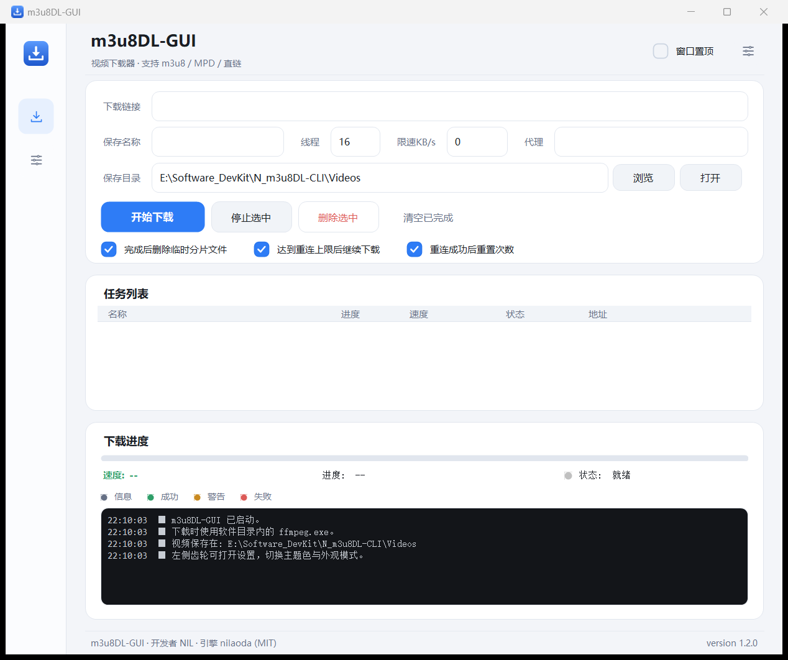
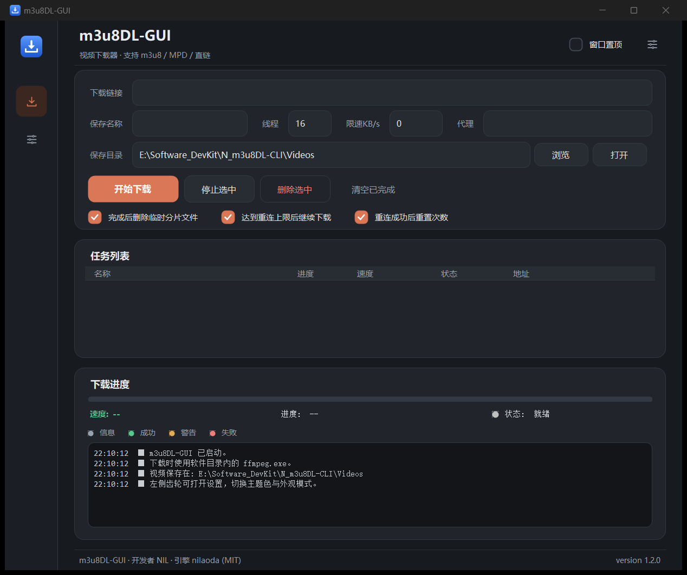
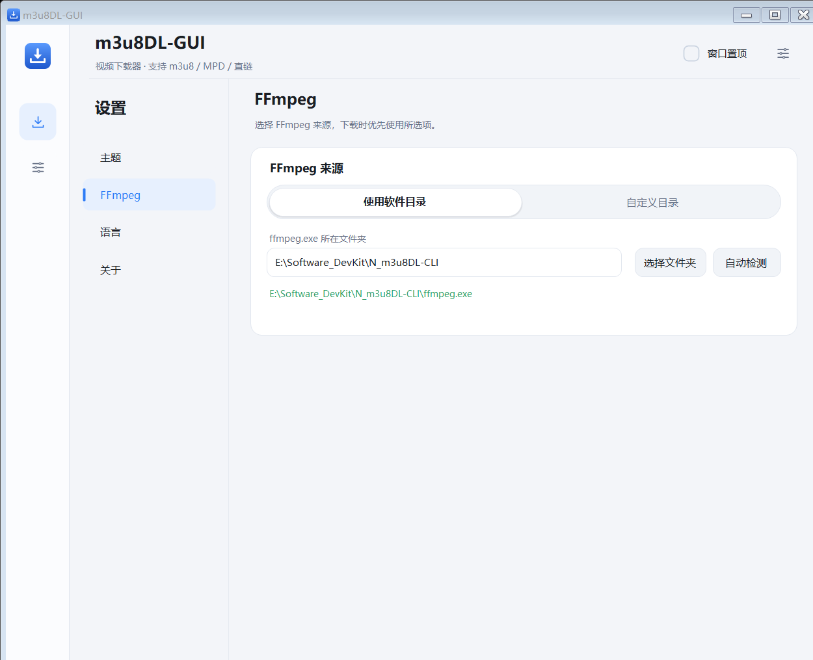
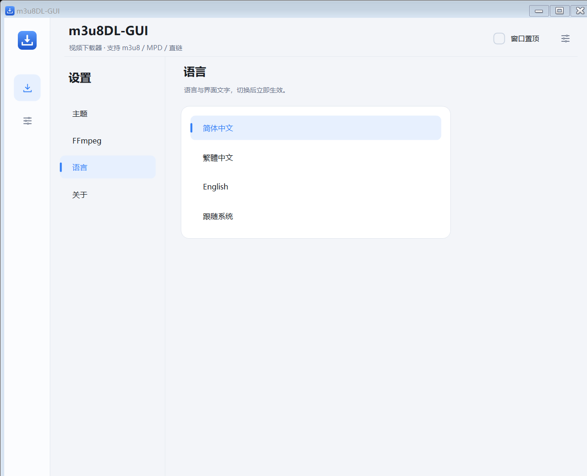

# m3u8DL-GUI

> 开源项目 **N_m3u8DL-CLI** 的非官方图形界面版，并非原作者发布的程序。
> 下载引擎与核心代码来自原作者 **nilaoda**，遵循 MIT 许可证。

一个面向 Windows 的 m3u8 / MPD / 直链视频下载工具。粘贴链接即可自动解析、分段下载、合并成片，结果保存在 `Videos` 文件夹。绿色免安装，整个目录复制到任意 Windows 电脑即可运行。

- 项目主页：<https://github.com/NILNILL/m3u8DL-GUI>
- 上游引擎：<https://github.com/nilaoda/N_m3u8DL-CLI>
- 当前版本：**1.2.0**



| 深色 · Claude 橙 | 设置 · FFmpeg | 设置 · 语言 |
| --- | --- | --- |
|  |  |  |

## 功能

| 功能 | 说明 |
| --- | --- |
| 下载 | 支持 m3u8 / MPD / 直链；多任务同时进行；可设线程、限速、代理与保存目录 |
| 断线续传 | 「达到重连上限后继续下载」「重连成功后重置次数」两个选项，重连节奏由界面接管 |
| 任务管理 | 任务列表显示名称、进度、速度、状态与地址；可停止、删除（连同分片一起清理）、清空已完成 |
| 日志 | 每个任务的进度固定一行原位刷新，解析 / 重连 / 合并 / 警告 / 错误各占新行，四色区分 |
| 主题 | 大肥鱼蓝 / Claude 橙 两种强调色，浅色 / 深色 / 跟随系统 三档外观，切换有缓动动画并自动保存 |
| 语言 | 简体中文 / 繁體中文 / English / 跟随系统；按提示重启后生效 |
| FFmpeg | 内置（软件目录）/ 自定义目录 / 自动检测（扫描系统 PATH），三种方式都支持 |
| 更新检查 | 在「关于」里检查 GitHub Releases，发现新版本可一键打开下载页 |
| 便携 | 引擎、依赖、ffmpeg 全部随包，不写注册表，不依赖系统安装的 ffmpeg |
| 记忆 | 主题、强调色、语言、FFmpeg 来源、线程、限速、窗口置顶与各勾选项都会保存，下次启动沿用 |

## 使用

1. 双击 `m3u8DL-GUI.exe`。
2. 粘贴视频地址，可选填保存名称、线程、限速、代理与保存目录。
3. 点「开始下载」，完成后到 `Videos` 查看。

命令行方式同样兼容原引擎参数：

```bat
m3u8DL-GUI.exe "https://example.com/playlist.m3u8" --workDir "E:\video" --saveName "abc"
```

## 设置

点右上角齿轮或左侧栏的齿轮进入设置页，左侧分为四个分区。

### 主题

- **主题色**：大肥鱼蓝（默认）/ Claude 橙。
- **外观模式**：浅色 / 深色 / 跟随系统，三档滑块。

### FFmpeg

| 方式 | 行为 |
| --- | --- |
| 使用软件目录 | 默认。优先调用程序根目录的 `ffmpeg.exe`，绿色便携，换电脑不用另装 |
| 自定义目录 | 手动选择包含 `ffmpeg.exe` 的文件夹；文件夹里没有该文件会提示重新选择 |
| 自动检测 | 扫描系统环境变量 `PATH`，找到 ffmpeg 所在文件夹并自动填入 |

面板下方会显示当前实际使用的 `ffmpeg.exe` 完整路径；找不到时以红色提示。

### 语言

简体中文 / 繁體中文 / English / 跟随系统。选择「跟随系统」时按 Windows 显示语言自动判断（繁中系统用繁體，其他非中文系统用 English）。

为避免界面出现「一半新语言、一半旧语言」的中间状态，**切换语言后会询问是否立即重启**：
选「是」保存设置并自动重启，选「否」则回退到切换前的语言，不做任何修改。

### 关于

版本号、下载引擎与许可证信息、项目地址，以及「检查更新」——数据来自 GitHub Releases，发现新版本会显示版本号并提供下载页入口。

## 目录结构

软件运行只需要下面这些，`src` / `docs` / `tools` 等开发目录可以直接删掉：

```text
m3u8DL-GUI\
├── m3u8DL-GUI.exe              主程序
├── ffmpeg.exe                  随包 ffmpeg（64 位）
├── README.md
├── Logs\                       运行日志
├── Videos\                     下载结果
├── runtime\                    下载引擎及其依赖（勿移动内部文件）
│   ├── N_m3u8DL-CLI-engine.exe
│   ├── BrotliSharpLib.dll
│   ├── CommandLine.dll
│   ├── MihaZupan.HttpToSocks5Proxy.dll
│   ├── Newtonsoft.Json.dll
│   ├── NiL.JS.dll
│   ├── System.Runtime.CompilerServices.Unsafe.dll
│   ├── UACHelper.dll
│   └── NO_UPDATE
└── assets\                     图标资源
    ├── m3u8dl-gui.ico
    └── m3u8dl-gui.png
```

说明：

- 根目录只放主程序、ffmpeg、说明与 `Logs` / `Videos` 两个数据目录。
- `runtime` 里的引擎和 DLL 必须放在一起，单独挪动会启动失败。
- 引擎的日志会临时写在 `runtime\bin\Logs`，程序启动/退出时自动搬到根目录 `Logs` 并清理空目录。

## 仓库结构（GitHub）

上传到 GitHub 时，仓库里额外包含开发用的源码、文档与验证工具：

```text
m3u8DL-GUI\
├── m3u8DL-GUI.exe
├── ffmpeg.exe
├── README.md
├── AGENTS.md                    给 AI 协作者的项目约定（可删）
├── .gitignore
├── .gitattributes
├── Logs\                        不纳入版本管理
├── Videos\                      不纳入版本管理
├── runtime\                     引擎 + 依赖
├── assets\                      图标
├── src\                         源码与构建脚本
│   ├── build.ps1
│   ├── AssemblyInfo.cs          版本号（唯一来源）
│   ├── m3u8DL-GUI.Main.cs       引擎调用、输出解析、重连、删除、设置读写
│   ├── m3u8DL-GUI.Ui.cs         界面装配、设置页、本地化、布局
│   ├── m3u8DL-GUI.Controls.cs   自绘控件（圆角卡片/按钮/滑块/输入框/动画泵）
│   ├── m3u8DL-GUI.Theme.cs      调色板、DPI 缩放、绘图原语
│   ├── m3u8DL-GUI.Lang.cs       简中/繁中/英文文案表
│   └── m3u8DL-GUI.Update.cs     GitHub Releases 版本检查
├── docs\
│   ├── CODEX_HANDOFF.md         开发交接文档
│   └── screenshots\             界面截图
└── tools\                       开发期验证工具（不参与构建）
    ├── Func.cs
    ├── ShotHarness.cs
    └── CaptureWindow.cs
```

## 构建

需要 .NET Framework 的 `csc.exe`（Windows 自带），无需 Visual Studio：

```powershell
powershell -ExecutionPolicy Bypass -File .\src\build.ps1
```

脚本会编译 `src\*.cs`，用 `assets\m3u8dl-gui.ico` 作为图标，输出 `m3u8DL-GUI.new.exe`。确认运行正常后替换根目录的 `m3u8DL-GUI.exe` 即可（替换前先关闭程序，否则文件被占用）。

## 运行环境

- Windows 10 / 11（Windows 7 SP1 可运行，但深色标题栏不生效）
- .NET Framework 4.6 或更高
- 无需另外安装 ffmpeg

界面会按系统 DPI 缩放（100% / 125% / 150%）自动放大，不会出现文字挤压。

## 设置文件

保存在 `%LOCALAPPDATA%\m3u8DL-GUI\settings.ini`，首次运行会自动沿用旧版 `N_m3u8DL-CLI` 目录下的配置。内容包括主题、强调色、语言、FFmpeg 来源、置顶状态与各勾选项。

## 常见问题

**只下到第一段却显示完成？**
旧版本只从系统 `PATH` 找 ffmpeg，换电脑后会中断。现在引擎始终优先使用随包的 ffmpeg，且只有「引擎退出码为 0 且输出文件非空」才判定完成。

**提示找不到 ffmpeg？**
到「设置 → FFmpeg」确认路径；可以点「自动检测」扫描系统 PATH，或手动选择包含 `ffmpeg.exe` 的文件夹。

**想换图标？**
替换 `assets\m3u8dl-gui.ico` 与 `assets\m3u8dl-gui.png` 即可（文件名保持不变），EXE 图标需重新构建才会更新。

## 来源与致谢

| 项目 | 说明 |
| --- | --- |
| 原始项目 | N_m3u8DL-CLI |
| 原作者 | nilaoda |
| 原项目地址 | <https://github.com/nilaoda/N_m3u8DL-CLI> |
| 许可证 | MIT License |

下载、解析、解密和合并等核心功能来自原作者，再分发时请保留原作者版权声明与 MIT 许可。

第三方组件包括 ffmpeg、Newtonsoft.Json、CommandLineParser、NiL.JS、BrotliSharpLib、HttpToSocks5Proxy 和 UACHelper，分别遵循各自的开源许可证。

## 免责声明

本程序仅供个人学习、技术研究及备份自己有权访问的内容。请勿下载或传播无权使用的内容，请勿用于商业或违法用途。
